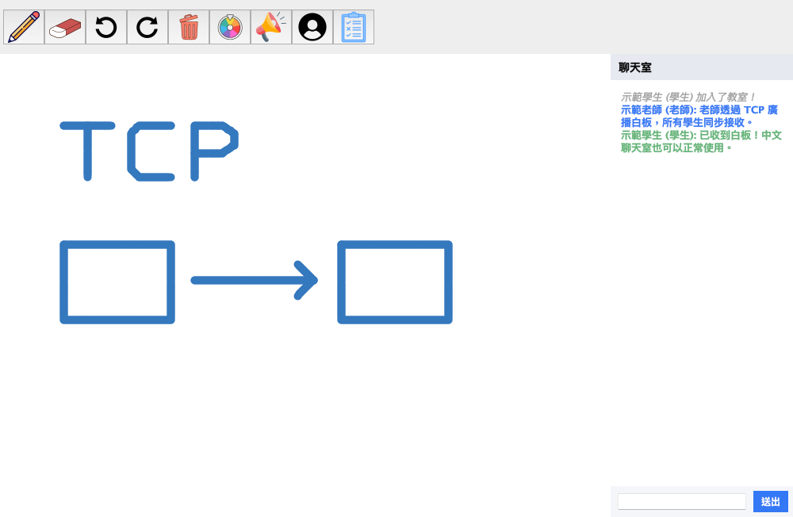
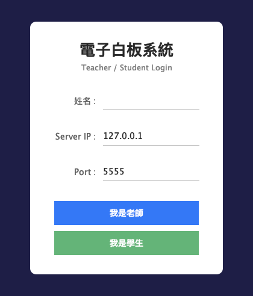
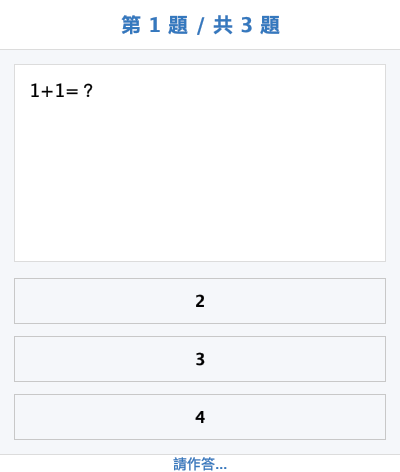
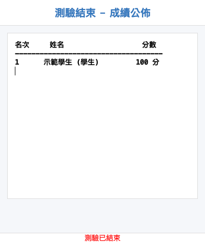
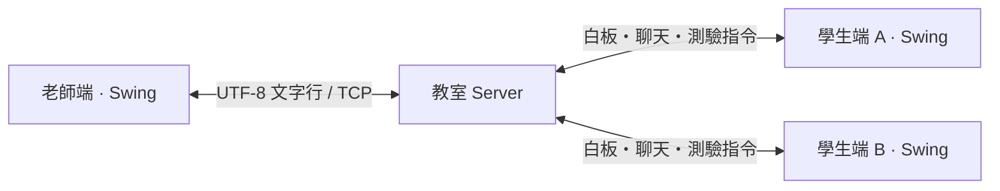

# E-Classroom｜即時互動電子教室

**網路程式設計期末專題 · Java Swing × TCP Socket**

以老師與學生的課堂互動為主題，實作可連線的桌面電子教室。老師書寫白板，學生即時觀看；搭配聊天室、舉手、公告、畫筆授權、抽籤與隨堂測驗，呈現多用戶通訊與事件同步的應用。



## 功能

| 功能 | 操作方式 |
| --- | --- |
| 即時共享白板 | 老師畫筆、顏色與粗細設定，透過 TCP 同步筆畫到學生端 |
| 白板編輯 | 橡皮擦、復原、重做、一鍵清空，操作同步到其他連線者 |
| 學生畫筆授權 | 老師從在線學生名單授予／收回權限，伺服器檢查白板操作權限 |
| 中文聊天室 | 老師與學生共用聊天室，依角色以不同顏色顯示訊息 |
| 舉手與公告 | 學生舉手通知老師；老師發布公告通知學生 |
| 在線名單與抽籤 | 取得目前學生名單，隨機抽出指定人數並廣播結果 |
| 隨堂測驗 | 老師發卷、切題；學生作答，老師端計分並公布排行榜 |

<table>
  <tr>
    <td align="center"><br>角色登入</td>
    <td align="center"><br>學生作答</td>
    <td align="center"><br>測驗結果</td>
  </tr>
</table>

## 快速開始

需要 **JDK 17 或更新版本**，以及可顯示視窗的桌面環境。程式只使用 Java 標準函式庫，不需要 Maven、Gradle、資料庫或額外 JAR。先在專案根目錄開啟終端機。

### macOS / Linux

```sh
# 編譯與封裝；修改程式後重新執行
sh scripts/build.sh

# 終端機 1：啟動教室伺服器
sh scripts/run.sh server

# 終端機 2：啟動登入視窗，選擇「我是老師」
sh scripts/run.sh client

# 終端機 3：再開一個登入視窗，選擇「我是學生」
sh scripts/run.sh client
```

同機展示請輸入不同姓名，Server IP 填 `127.0.0.1`，Port 填 `5555`。每個伺服器容納一位老師與多位學生。跨電腦展示時，讓各電腦連上同一區域網路，學生輸入伺服器啟動時列出的區域網路 IP，並允許該 TCP 連接埠通過防火牆。

### Windows PowerShell

```powershell
.\scripts\build.ps1

# 分別在不同終端機執行
.\scripts\run.ps1 -Mode server
.\scripts\run.ps1 -Mode client
.\scripts\run.ps1 -Mode client
```

### 直接執行 JAR

建置產物位於 `dist/eclassroom.jar`，內含所有圖示，可以從其他目錄執行。

```sh
# 伺服器，最後一個參數可自訂連接埠
java -cp dist/eclassroom.jar eclassroom.Server 5555

# 老師／學生共用登入程式
java -jar dist/eclassroom.jar
```

自訂連接埠也可用 `sh scripts/run.sh server 6000` 或 `.\scripts\run.ps1 -Mode server -Port 6000`；登入時填入相同 Port。停止伺服器按 `Ctrl+C`，關閉客戶端視窗即離線。

## 技術設計



- **通訊：** `ServerSocket` 接受連線，每個客戶端由獨立執行緒接收；依指令轉送給全部成員、其他成員、老師或指定學生。
- **介面：** Swing 建立登入、工具列、聊天室與測驗視窗。背景執行緒處理連線，介面更新集中在 Swing 事件執行緒。
- **白板：** 將筆畫拆成開始、移動、結束事件；以操作堆疊保存復原／重做，發送端直接更新本地，伺服器轉送給其他成員。
- **測驗：** 老師端保存正解並計分；伺服器轉送題目及答案，限制每位學生每題提交一次，答錯者仍以 0 分列入成績。

## 專案結構

```text
.
├── README.md
├── CHANGELOG.md
├── src/
│   ├── main/java/eclassroom/    # 伺服器、老師／學生介面與通訊邏輯
│   ├── main/resources/icons/   # 隨 JAR 封裝的工具列圖示
│   └── test/java/eclassroom/    # 核心、TCP 整合與桌面流程檢查
├── scripts/                    # macOS/Linux 與 PowerShell 建置、執行、測試
├── docs/                       # 架構、協定、展示流程、版本整理與截圖
└── .github/workflows/java.yml  # 跨系統與 Java 版本的自動測試
```

## 驗證

```sh
sh scripts/test.sh

# 需要圖形桌面：實際操作視窗，重新產生 docs/assets 的展示畫面
sh scripts/preview.sh
```

Windows 的核心與 TCP 測試使用 `.\scripts\test.ps1`。測試不需下載任何套件；TCP 測試會在本機使用系統分配的臨時連接埠。

本地已在 macOS、OpenJDK 26.0.1 上，以 `--release 17` 建置並通過核心、TCP 與桌面展示流程。其他平台由隨附的 CI 設定驗證；尚未執行遠端 CI。詳細範圍見 [驗證紀錄](docs/VERIFICATION.md)。

## 文件與展示

- [五分鐘展示流程](docs/DEMO.md)
- [架構與模組說明](docs/ARCHITECTURE.md)
- [TCP 通訊協定](docs/PROTOCOL.md)
- [最終版本判定與 13 個原始版本比較](docs/VERSION_AUDIT.md)
- [上傳 GitHub 與作品介紹文案](docs/GITHUB.md)

## 目前範圍

這是單一教室的桌面專題。角色由登入時選擇，沒有帳號密碼驗證；教室、白板與成績資料只保存在記憶體中。新加入者會收到加入後的白板事件，尚未補送既有畫面。白板以輪流書寫為展示情境，未實作同時繪圖的衝突處理。測驗使用三道內建示範題，可修改 `QuizTeacher.loadQuestions()` 的題目、選項、正解與配分。

原始構想中的白板回放、課堂紀錄、檔案傳輸、JSON 題庫匯入及網頁介面列為後續方向。原始快照保留在本機上層的 `../ip/`，不包含在此專案中；本專案以 `eclassroom_0o0` 為整理基底，完整判定依據記錄於版本報告。
