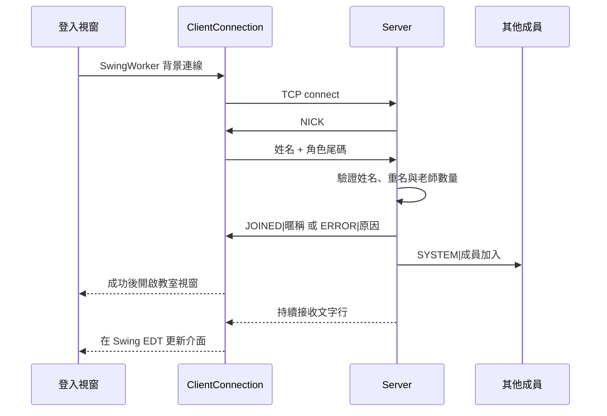

# 系統架構

E-Classroom 是使用 Java 標準函式庫建立的桌面專題。一個伺服器維護一間教室、一位老師與多位學生；資料不會寫入資料庫。

## 模組

| 類別 | 責任 |
| --- | --- |
| `Main` | 登入表單、欄位驗證、背景建立連線 |
| `ClientConnection` | 有逾時的 TCP 交握、UTF-8 收送、斷線處理、將訊息交給 Swing 執行緒 |
| `Server` | 登入與角色檢查、成員名單、白板授權、訊息路由、測驗提交去重 |
| `TeacherClient` / `StudentClient` | 組合教室介面並處理各自的課堂事件 |
| `WhiteboardProtocol` | 共用的白板指令解碼，依序套用遠端操作 |
| `WhiteboardPanel` / `LineData` | 線段模型、繪製、橡皮擦、操作復原與重做 |
| `ToolbarFactory` / `ToolMode` | 共用工具列與目前繪圖工具 |
| `Chatbox` / `NotificationUtil` | 聊天文字樣式與課堂通知 |
| `OnlineStudentsWindow` / `StudentPicker` | 學生名單、授權控制、隨機抽籤 |
| `QuizTeacher` / `QuizStudent` / `QuizScoreboard` | 題目展示、答案提交、去重計分及排行榜 |
| `AppResources` | 從 JAR 載入圖示，讀不到圖片時使用文字按鈕 |

## 連線流程

## 同步策略

白板發送端先更新本地，再送出操作；伺服器只轉送給其他人，避免重複套用。聊天訊息送到全部成員，讓發送者也能看到自己的訊息。舉手與作答只送給老師；授權只送給指定學生。

`WhiteboardPanel` 將一整筆線段視為一個可復原操作，橡皮擦與清空也各自保存操作狀態。復原堆疊是每個客戶端的記憶體資料，必須從同一批事件累積。尚未保存白板歷史或為晚加入者建立快照，因此展示時先讓所有成員登入，再開始書寫，並輪流操作白板。

伺服器以每連線一執行緒接收訊息，並使用共用鎖依序更新教室狀態與轉送。這個設計適合課堂規模示範；伺服器目前同步寫入各 socket，尚未加入慢速客戶端的佇列或大型併發負載控制。

測驗正解與分數由老師端持有，伺服器只維護當前題號及提交去重狀態。關閉伺服器會清除教室資料；老師離線會結束學生測驗並收回學生畫筆權限。老師重新加入不會還原前一位老師的題庫或成績。
