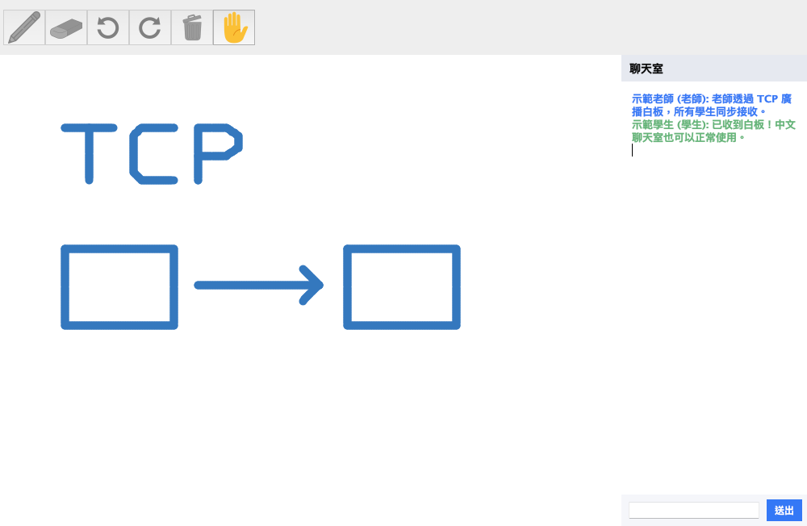
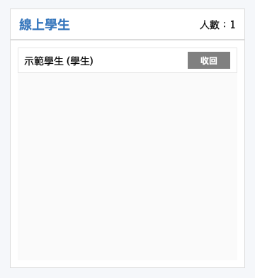
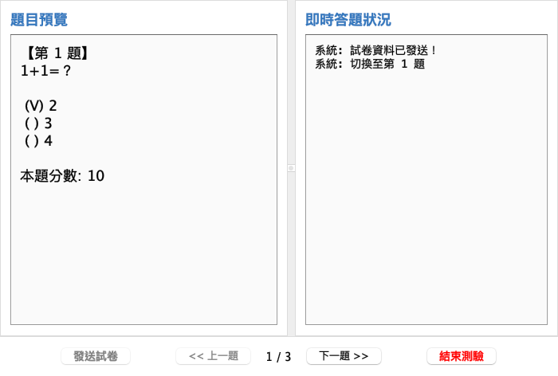

# 五分鐘展示流程

先依 README 建置並開啟一個伺服器、一個老師端與兩個學生端。所有成員先登入，再開始白板示範，視窗維持相同大小。

| 時間 | 操作 | 可說明的重點 |
| --- | --- | --- |
| 0:00–0:40 | 老師及學生分別輸入姓名，連到同一 IP 與 Port | TCP 連線、角色與多客戶端架構 |
| 0:40–1:40 | 老師畫幾筆，改色、擦除，再復原／重做與清空 | 筆畫事件同步、操作堆疊、避免回送重複事件 |
| 1:40–2:20 | 學生傳中文訊息、按舉手；老師發布公告 | 不同事件的訊息路由與即時互動 |
| 2:20–3:00 | 老師按「在線學生」，授權一位學生書寫，最後收回 | 介面控制及伺服器檢查權限 |
| 3:00–3:30 | 老師開啟抽籤，設定 1 人並廣播結果 | 取得在線學生清單、隨機抽樣 |
| 3:30–4:40 | 老師開啟測驗、發卷、依序切題；學生作答；老師結束測驗 | 題目同步、答案回傳、去重與排行榜 |
| 4:40–5:00 | 說明模組與目前限制 | 白板晚加入補同步、同時繪圖、持久化等後續方向 |

工具列圖示可將滑鼠移上查看中文名稱。老師畫筆及橡皮擦按鈕會開啟設定視窗，選好後關閉小視窗再書寫。學生尚未授權時，繪圖工具停用，仍可聊天及舉手。學生名單需要更新時，再按一次老師端的「在線學生」或「抽籤」按鈕。

示範題依序為 `1+1`、課程名稱、資工系英文縮寫；正確選項索引依序為 0、1、1，配分 10、45、45。每題第一份答案有效，回到前題不開放重答。結束後學生保留結果畫面；老師關閉測驗視窗會關閉學生測驗，再開測驗視窗可進行新一輪。

## 畫面

以下是桌面流程驗證時，從實際 Swing 視窗內容匯出的 PNG；使用示範姓名及本機連線。可用 `sh scripts/preview.sh` 重現登入、白板、聊天、授權及測驗畫面。

| 在線學生授權 | 老師測驗控制台 |
| --- | --- |
|  |  |

## 常見問題

| 現象 | 處理方式 |
| --- | --- |
| 找不到 `javac` 或 `jar` | 安裝完整 JDK，確認其 `bin` 在 PATH 中 |
| 無法連線 | 先啟動伺服器，核對 IP／Port；跨電腦時檢查區域網路與防火牆 |
| Port 已被占用 | 關閉前一個伺服器，或改用其他連接埠，客戶端也填同一 Port |
| 已有老師或同名角色 | 使用不同姓名；同一伺服器一次只能一位老師 |
| 新學生看不到先前白板 | 目前未補送歷史；先讓所有人登入，再開始書寫 |
| 修改程式後仍是舊行為 | 重新執行建置腳本；執行腳本只在 JAR 不存在時自動建置 |
| 伺服器斷線 | 客戶端會停用操作，關閉視窗後重新執行登入程式 |
